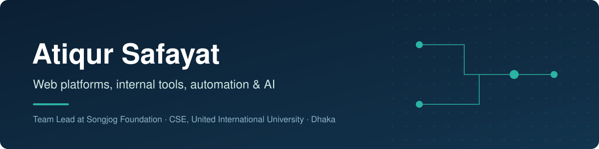

  
  
  

Hi, I'm Atiqur. I look after the websites, internal apps and automation at [Songjog Foundation](https://songjog.org), a nonprofit registered in Bangladesh and the USA. I joined as a volunteer in 2020 and I'm now a team lead there, while finishing my CSE degree at United International University.

Songjog runs home care and healthcare services, a care and rehabilitation home, skills and IT training, a scholarship program and a volunteer network, so the work covers a lot of ground. Lately I've been bringing AI into it.

## What I work on

- Web platforms with Django, Odoo, WordPress and Laravel
- Apps and automation for daily operations with AppSheet, Apps Script, Make.com and Retool
- Product planning for outside development teams: specs, user flows and UI
- Design: branding, UI, graphics, video editing and motion

## Live projects

**Websites**
- [songjog.org](https://songjog.org): the main Songjog Bangladesh site. I designed it, planned the features and set it up on Odoo.
- [songjogfoundation.org](https://songjogfoundation.org): turned a static page into a dynamic WordPress site and redesigned it.
- [songjogcare.com](https://songjogcare.com) and [caregiver.songjogcare.com](https://caregiver.songjogcare.com): I did the UI and frontend for the client and caregiver sides, and designed the mobile app.
- [songjogshop.com](https://songjogshop.com): our online shop on Bagisto. I also wrote a bKash payment gateway for Bagisto and published it as a package.
- [verify.songjog.org](https://verify.songjog.org): anyone can check a Songjog training certificate here. It pulls records from our training system.
- [svb.songjog.org](https://svb.songjog.org): volunteer website and portal built with Django, in final testing.
- [pilot-isd.songjog.org](https://pilot-isd.songjog.org): skills training platform. An outside team built it, and I worked out the features, flows and UI guidelines with them.

**Internal apps (AppSheet and Apps Script)**
- Care home app for patient records, vital signs, hospital visits and stock
- Qurbani management: matching donors with sacrifices, assigning volunteers and sending receipts
- Apps for caregiver training and certificates, scholarship records, inventory and email campaigns (MailReach)
- A daily check of our electricity meter balance that posts the result to the team's Google Chat

**Other work**
- BONDHU: a companion robot for elderly people, built on Raspberry Pi. It talks with the user, senses presence with an mmWave radar and gives reminders.
- Jotner Pesha (Care as a Profession): an animated Bangla series for caregiver training and recruitment. I built the animation pipeline in Remotion.

## Open source

- [bagisto-bkash-v2](https://github.com/atiqursafayat/bagisto-bkash-v2): bKash API v2 payment gateway for Bagisto, on [Packagist](https://packagist.org/packages/atiqursafayat/bagisto-bkash-v2)

## Tools

  

  
  
  
  
  
  
  
  
  
  

## Get in touch

If you're working on tech for nonprofits, healthcare or education and want to collaborate, email me at [atiqursafayat@gmail.com](mailto:atiqursafayat@gmail.com).
